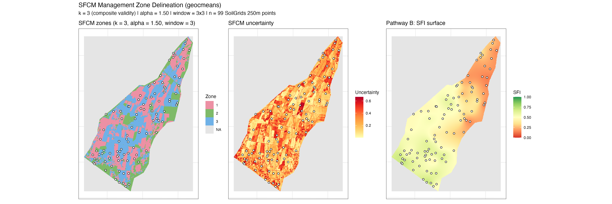
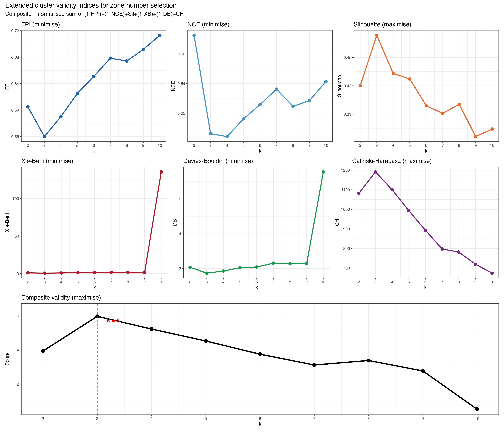
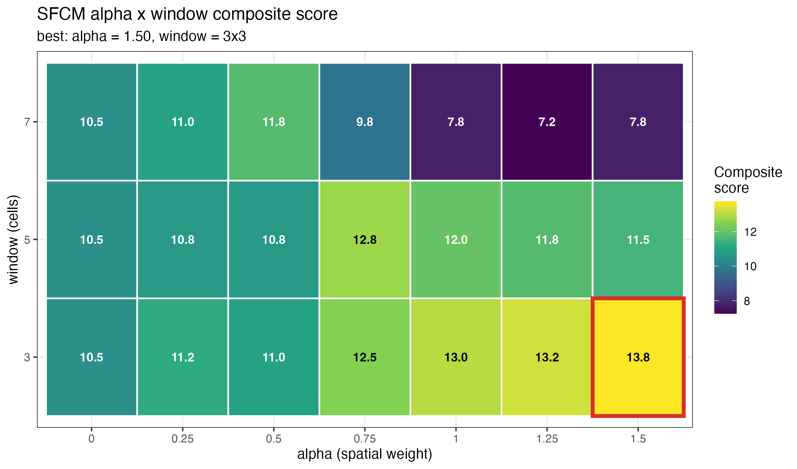

# Spatial Fuzzy C-Means (SFCM) Management Zone Delineation

A modular, reproducible R pipeline for agricultural management zone delineation combining **10 m satellite embedding PCA** with **Spatial Fuzzy C-Means (`geocmeans`)** and an **AHP-weighted Soil Fertility Index (SFI)** interpolated via Ordinary Kriging from **SoilGrids 250 m** data (northern coastal Peru, EPSG:32717).



> **Related Work — Direct Extension:** This repository implements every extension proposed in the *"Future work"* section of [Delineating Soil Management Zones for Precision Agriculture using R](https://medium.com/@cmcarbajal/delineating-soil-management-zones-for-precision-agriculture-using-r-94bc8aca8408) (and complements the soil-point FCM toolkit in [`ccarbajal16/Delineation_MZ`](https://github.com/ccarbajal16/Delineation_MZ)):
> 1. **6-index composite validity (`FPI`, `NCE`, `Silhouette`, `Xie-Beni`, `Davies-Bouldin`, `Calinski-Harabasz`)** replacing single-metric Silhouette selection (`k = 10` → optimal `k = 3`).
> 2. **Full-grid Spatial Fuzzy C-Means (`geocmeans::SFCMeans`)** across all 1.57M pixels, eliminating the 3,000-pixel `ClustGeo` subsampling bottleneck.
> 3. **Confusion Index & Uncertainty rasters** to explicitly map boundary ambiguity.
> 4. **Pathway B — AHP-weighted Soil Fertility Index (SFI)** interpolated via Ordinary Kriging.
> 5. **Spatial & statistical validation** via Kruskal–Wallis, Dunn post-hoc tests, and raw vs. residual Moran's I.

---

## Overview

The workflow implements two complementary spatial pathways driven by a single YAML configuration (`config/default_config.yaml`):

| Pathway | Input Data | Method | Primary Output |
|---|---|---|---|
| **Pathway A — Spatial Zoning** | 10 m satellite embedding PCA (10 PCs, 1,572,339 pixels) | 6-index composite validity (`k = 2..10`) + `geocmeans::SFCMeans` (`m = 1.5`, tuned `alpha` & `window`) | Hard zones (`zones_sfcm.tif`), fuzzy memberships, uncertainty & confusion maps |
| **Pathway B — Fertility Surface** | 99 SoilGrids 250 m points (`SOC`, `N`, `CEC`, `pH`, `BD`) | Fuzzy indicator scoring + AHP weighting + Ordinary Kriging (`automap::autoKrige`) | Continuous SFI (`zones_sfi.tif`), fertility classes & kriging variance |

---

## Key Results (Reproducible Run)

- **Optimal zone count (`k = 3`):** Unanimously supported by the 6-index composite score (**5.97 / 6.00**; `FPI = 0.560`, `NCE = 0.606`, `Silhouette = 0.473`, `Xie-Beni = 0.601`, `DB = 1.73`, `CH = 1192`), yielding balanced sample coverage across zones (`n = 38, 22, 39`).
- **Spatial regularization (`alpha = 1.50`, `3x3` window):** Reduces spatial inconsistency (`spConsistency`) by **33%** on the full 1.57M-pixel grid (`11.02` at `alpha = 0` → `7.37` at `alpha = 1.50`) while preserving attribute cohesion (`Silhouette = 0.476`, explained inertia `= 0.206`).
- **AHP Soil Fertility Index:** Active 5-indicator composite (`SOC = 0.35`, `N = 0.28`, `CEC = 0.18`, `pH = 0.12`, `BD = 0.07`) spanning **0.135 – 0.731** (mean `0.449`), capturing a clear NE–SW fertility gradient across the valley.
- **Honest Scale-Mismatch Finding:** Kruskal–Wallis + Dunn post-hoc tests show significant separation across the 10 m zones for **`pH`** (`p = 0.0054`; Zone 2 vs. Zone 1 `p_adj = 0.0127`, Zone 2 vs. Zone 3 `p_adj = 0.0086`) and **`Silt`** (`p = 0.0333`), while residual Moran's I remains elevated (`0.23–0.75`) for the other SoilGrids variables. This demonstrates that **10 m satellite embeddings resolve fine parcel-level structure**, whereas **250 m SoilGrids layers capture broad regional trends**—underscoring why operational variable-rate prescriptions should be calibrated with field soil sampling.

<p align="center">
  
  
</p>

---

## Quick Start (Reproducibility)

### 1. Prerequisites
- **R >= 4.3** (tested on R 4.6; exact package versions are recorded in [`session_info.txt`](session_info.txt)).
- System geospatial libraries (`GDAL`, `GEOS`, `PROJ`) required by `terra` and `sf`.
- Missing CRAN packages are installed automatically on first run by `R/setup.R`.

### 2. Run the Full Pipeline

```bash
git clone https://github.com/ccarbajal16/sfcm-management-zones.git
cd sfcm-management-zones
Rscript main.R
```

All outputs are regenerated deterministically (fixed seeds) into:
- `data/zones_*.tif` & `data/sfi_kriging_variance.tif` (GeoTIFF rasters, git-ignored)
- `outputs/*.csv` (validity indices, alpha sweep, zone profiles, Kruskal–Wallis, Dunn post-hoc, raw & residual Moran's I, fertility prescriptions)
- `figures/29_*.png` – `figures/40_final_figure.png` (300 dpi figures)

### 3. Customizing Parameters

Edit [`config/default_config.yaml`](config/default_config.yaml) or pass runtime overrides inside R:

```r
source("main.R")
# Override k, fuzziness, or alpha grid without editing YAML:
res <- main(list(k_final = 4, fuzziness = 1.4))
```

---

## Repository Structure

```text
sfcm-management-zones/
├── main.R                         # Pipeline orchestrator (Steps 01–08)
├── config/
│   └── default_config.yaml        # All model, SFI, and threshold parameters
├── R/
│   ├── config.R                   # YAML loader & schema validator
│   ├── setup.R                    # Package loader & output dir setup
│   ├── step_01_pca_raster.R       # Load 10-band PCA raster (10 m)
│   ├── step_02_pca_soil.R         # Load & project SoilGrids 250 m points
│   ├── step_03_sfcm.R             # k-selection via 6-index composite validity
│   ├── step_04_sfcm_alpha.R       # SFCM alpha x window sweep & full-grid fit
│   ├── step_05_profiling.R        # Zone summary stats, boxplots & radar chart
│   ├── step_06_kriging.R          # AHP-SFI scoring & Ordinary Kriging
│   ├── step_06_validation.R       # Kruskal-Wallis, Dunn post-hoc & Moran's I
│   ├── step_07_prescriptions.R    # Agronomic fertility status per zone
│   ├── step_08_final_figure.R     # 3-panel publication summary figure
│   └── helpers/                   # Pure helper modules (validity, SFI, spatial, viz)
├── data/
│   ├── embedding_pca.tif          # 10-band lossless GeoTIFF (48 MB)
│   └── soilgrids_with_embeddings.csv  # 99 SoilGrids 250 m reference points
├── outputs/                       # Pre-computed CSV tables from reference run
├── figures/                       # Pre-computed 300 dpi PNG figures
├── session_info.txt               # Exact R & package versions for reproducibility
├── .gitignore
└── LICENSE
```

---

## Data Notes & Limitations

- `data/embedding_pca.tif` contains the first 10 principal components of 10 m satellite embeddings (lossless `DEFLATE + PREDICTOR=3` GeoTIFF, EPSG:32717).
- `data/soilgrids_with_embeddings.csv` contains **SoilGrids 250 m modeled soil properties** (not laboratory-analyzed soil profiles), used here to demonstrate the end-to-end zoning and SFI methodology.

## License

MIT License — see [`LICENSE`](LICENSE).
